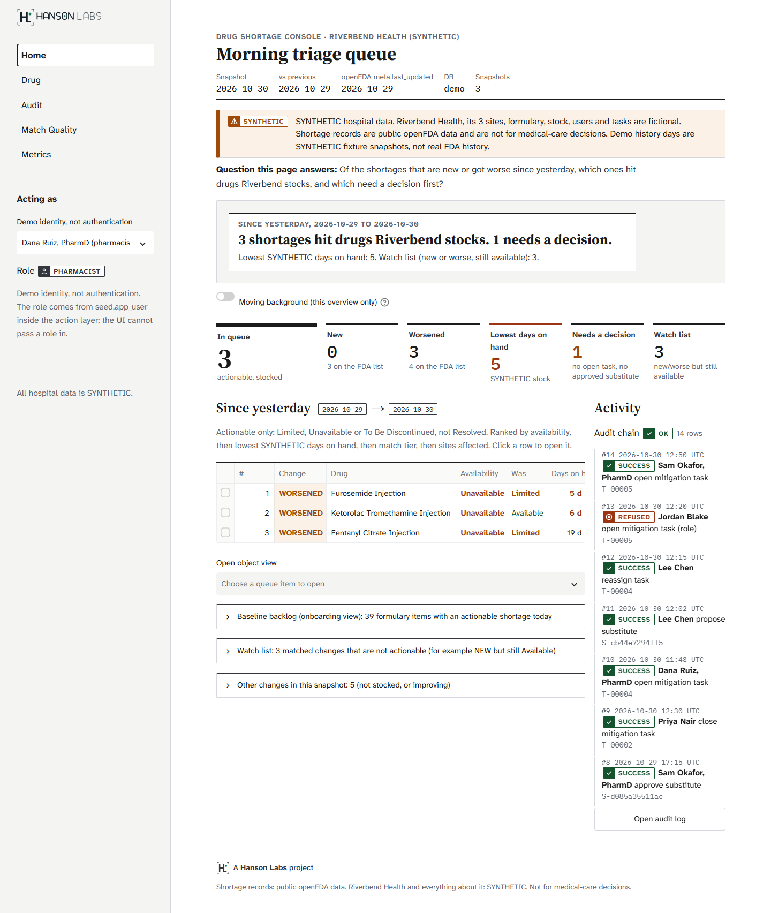
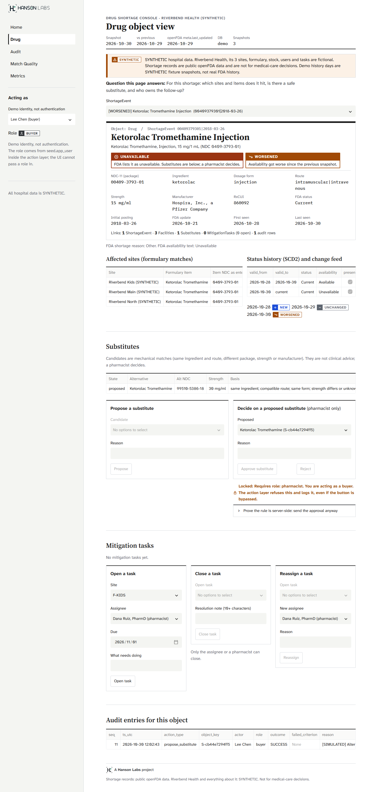
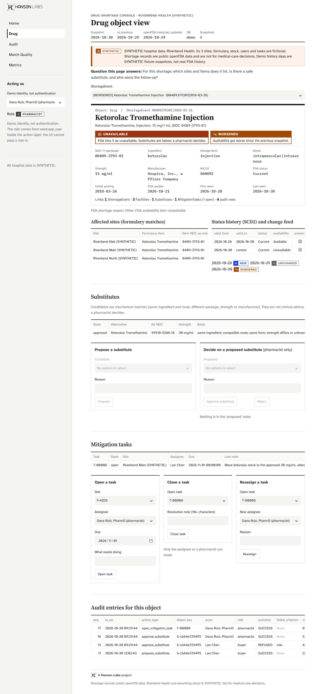
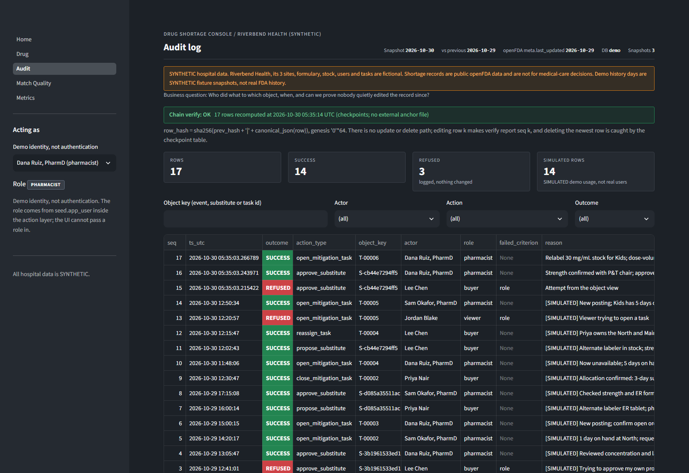
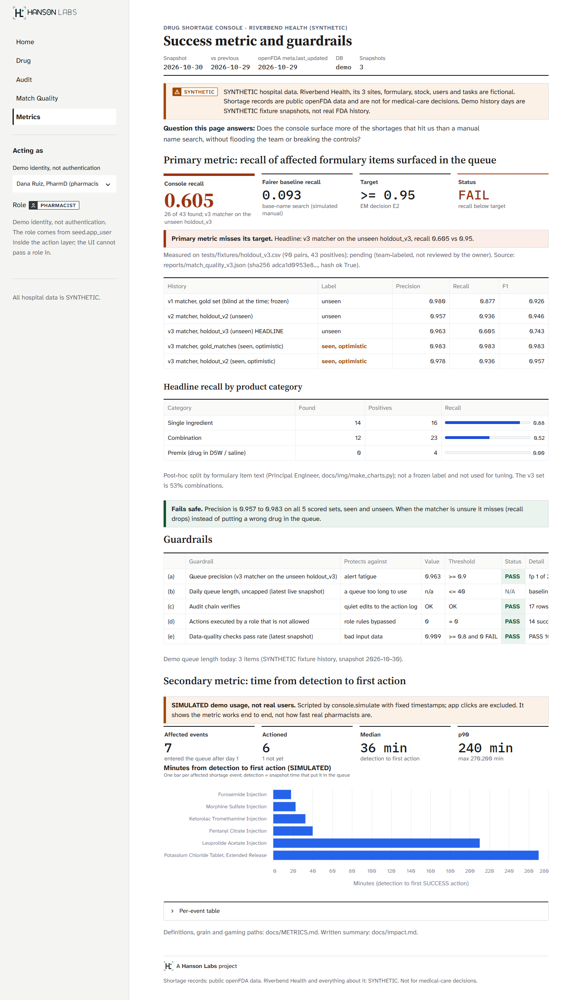
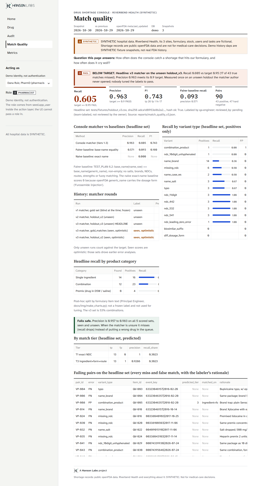
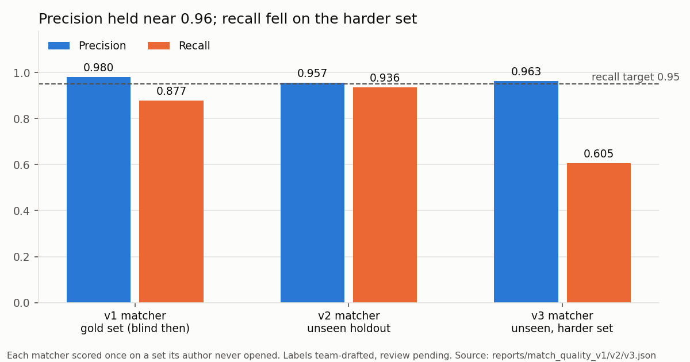
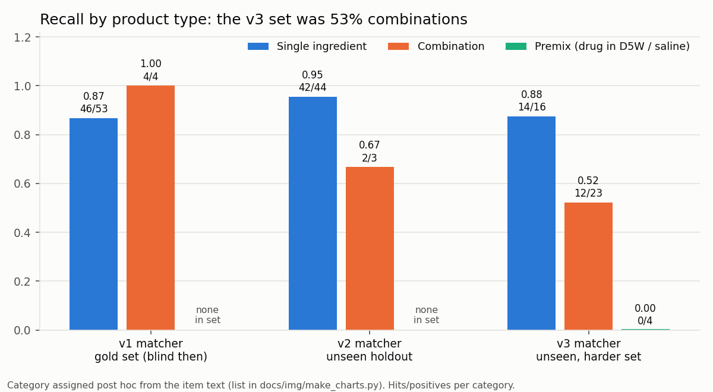
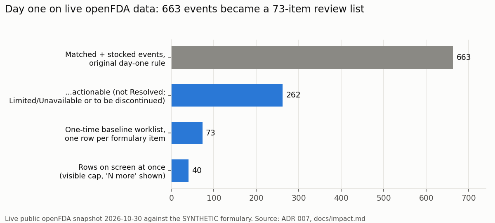
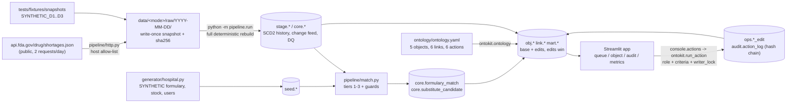

# Drug Shortage Operations Console

A Foundry-style operations console on the **live public openFDA Drug Shortages API**. It keeps the daily history the FDA does not, matches shortage records to a hospital formulary across NDC formats, salts, brands and typos, and gives a pharmacist one ranked morning queue with role-checked actions, write-back and a hash-chained action log.

> **Data honesty.** Shortage records are real public openFDA data. Riverbend Health (3 sites), its formulary, stock, users, tasks and all usage are **SYNTHETIC**. The demo history days are SYNTHETIC fixture snapshots. This is a demonstration project; it has not been deployed or used by a real pharmacy. Labels for match quality are team-drafted and **not yet reviewed by a pharmacist**.

**In 5 minutes:** [Executive one-pager](docs/EXECUTIVE_ONE_PAGER.md) · [Brief](docs/BRIEF.md) · [Case study](docs/CASE_STUDY.md) · [Flaw hunt](docs/FLAW_HUNT.md) · [Known issues](docs/KNOWN_ISSUES.md)

## Results at a glance

Every number below comes from a run output: `reports/match_quality_v1.json`, `_v2.json`, `_v3.json`, `reports/impact_metrics.json`, `docs/results.json`, and the FLAW_HUNT runs on 2026-10-30.

| What | Result | Source |
|---|---|---|
| **Matcher on the newest blind set (v3, harder: 53% combinations)** | **Precision 0.963, recall 0.605** (26 of 43; 1 false match). Recall target 0.95: **not met** | `match_quality_v3.json` `holdout_v3_unseen` |
| Matcher on the previous blind set (v2, mostly single-ingredient) | Precision 0.957, recall 0.936 (44 of 47) | `match_quality_v2.json` `holdout_unseen` |
| Matcher v1 on the gold set (blind at the time) | Precision 0.980, recall 0.877 | `match_quality_v1.json` |
| Base-name search (the fair baseline) on v3 / v2 | Recall 0.093 / 0.234; precision 0.571 / 0.579 | same files, `baseline_v2` |
| Day-one queue on the live snapshot (2026-10-30) | 663 matched events (from 1,614 raw records) reduced to a **73-item** baseline review list (ADR 007) | ADR 007, `docs/impact.md` |
| Guardrails (demo DB) | Audit chain OK (14 rows); 0 actions by a disallowed role (2 attempts refused and logged); DQ pass rate 0.909, 0 FAIL | `reports/impact_metrics.json` |
| Tests | **312 passed, 0 failed**, 2 skipped (live API) | `docs/results.json` |
| Concurrency race fix | 11 of 15 runs failed before; **0 of 20** after; removing the lock fails 5 of 5 | [postmortem](docs/POSTMORTEM_concurrency_race.md) |
| Rebuild idempotency | 20 of 21 tables byte-identical on a second build; the 21st differs only by run id and timestamp; edits and audit survive | [FLAW_HUNT](docs/FLAW_HUNT.md) row 1 |

**The decision behind the numbers.** Precision held between 0.957 and 0.980 on all three blind sets. Recall depends on the mix: single-ingredient recall stayed between 0.87 and 0.95, combinations fell to 0.52 (12 of 23) and premixed bags to 0 of 4 on v3. The matcher fails **safe**: a miss leaves the item to the pharmacist's normal review, while a false match could put a wrong substitute in front of her. We stopped tuning at v3; v4 fixes and a new blind set are on the [roadmap](docs/ROADMAP.md). The gold set now scores 0.982, but that set drove the fixes, so it is a regression check and never the headline.

The app's Metrics and Match Quality pages headline the same v3 blind result (BUG-PE-01, fixed).

## See it without running it

Screenshots of the full click-through (queue, object, action, audit), taken on a scratch copy of the demo DB:

| | |
|---|---|
|  **1. Morning queue.** NEW or WORSENED since yesterday, stocked, actionable, ranked, capped at 40. |  **2. Buyer view.** Approve is disabled with the ontology's reason; forcing it is refused server-side and logged. |
|  **3. Pharmacist approves** a substitute and opens a task; no rebuild needed. |  **4. Audit page.** Chain verifies; the buyer's REFUSED attempt sits next to the SUCCESS rows. |
|  **5. Metrics.** Guardrails and the SIMULATED time-to-action. |  **6. Match quality.** Per tier, per variant, every failing pair with its rationale. |

Phone-width (375 px) versions are in [docs/demo/mobile/](docs/demo/mobile/). The optional moving background (Home overview only, off by default) is shown in [01b_queue_background_on.png](docs/demo/01b_queue_background_on.png). Design notes and before/after: [docs/team/DESIGN_REVIEW.md](docs/team/DESIGN_REVIEW.md).

## Infographics

Rendered by `python docs/img/make_charts.py` (needs matplotlib) from the report files.







## Architecture



Pipeline-owned schemas are dropped and rebuilt every run; action-owned schemas (`ops`, `audit`) are never touched by the pipeline, so write-back survives every rebuild. Full design: [DESIGN.md](docs/team/DESIGN.md).

## Foundry concept to this repo

> **Stand-in, not Foundry.** This repo is built with open-source tools (DuckDB, Python, Streamlit) to imitate Foundry concepts. It does not use Palantir software. Concept names follow Palantir's public documentation: https://www.palantir.com/docs/foundry/ (Ontology, object types, link types, action types).

| Foundry concept | Here | Where |
|---|---|---|
| Ontology | One YAML file, the single source for views, models and action rules | `ontology/ontology.yaml`, `ontokit/ontology.py` |
| Object types | `Drug`, `ShortageEvent`, `Substitute`, `MitigationTask`, `Facility`, each with a primary key checked unique | `obj.*` views; `ontokit.ontology.check_backing` |
| Link types | `drug_shortage_event`, `shortage_event_facility`, `shortage_event_substitute`, `substitute_alt_drug`, `shortage_event_task`, `task_facility` | `link.*` views |
| Action types | `propose_substitute`, `approve_substitute` (pharmacist only), `reject_substitute`, `open_mitigation_task`, `close_mitigation_task`, `reassign_task` | `console/actions.py` via `ontokit/actions.py` |
| Submission criteria | Named predicates in declared order; the first failure is logged by id (`state_is_proposed`, `alt_not_short`, `not_already_decided`, ...) | `ontology.yaml` `criteria`, `console/actions.py` |
| Write-back dataset | Append-only edit tables; object views take the latest edit over the pipeline base | `ops.substitute_edit`, `ops.mitigation_task_edit`, `ontokit/writeback.py` |
| Action log | Every attempt (SUCCESS or REFUSED) in a hash-chained log with checkpoints and an optional anchor | `audit.action_log`, `ontokit/audit.py` |
| Function-backed rules | Python predicates over the ontology, e.g. `alt_not_short` (the substitute is not itself short in the latest snapshot) and the ADR 007 actionable filter | `console/actions.py`, `mart.triage_queue` |
| Pipeline / transforms | Snapshot store, SCD2 history, change feed, DQ checks, matcher | `pipeline/` |
| Workshop app | Streamlit pages that hold no business logic | `app/` |
| Reusable library (Dev vs Delta) | `ontokit`: domain-free ontology, actions, write-back, audit | `ontokit/` (ADR 005) |

## Quickstart

Needs Python 3.12+ (tested on 3.13.0). Offline: the demo uses SYNTHETIC fixture snapshots, so no API key, no network and no LLM are needed. Dependencies are pinned in `requirements.txt` (runtime) and `requirements-dev.txt` (adds pytest, ruff, and matplotlib for the README charts).

**Windows (PowerShell)**

```powershell
python -m venv .venv
.\.venv\Scripts\python.exe -m pip install -r requirements.txt
.\.venv\Scripts\python.exe -m pipeline.run --fixtures      # build data/demo/console.duckdb (SYNTHETIC)
.\.venv\Scripts\python.exe -m console.simulate             # optional: SIMULATED demo usage for the Metrics page
.\.venv\Scripts\python.exe -m streamlit run app/Home.py    # http://localhost:8501
```

Or in one step: `powershell -ExecutionPolicy Bypass -File .\run_demo.ps1`.

**macOS / Linux**

```sh
python3 -m venv .venv
.venv/bin/python -m pip install -r requirements.txt
.venv/bin/python -m pipeline.run --fixtures
.venv/bin/python -m console.simulate
.venv/bin/python -m streamlit run app/Home.py
```

Or in one step: `sh run_demo.sh`. (The macOS/Linux commands have not been run by the team yet; only Windows was measured.)

**Tests:** `pip install -r requirements-dev.txt`, then `python -m pipeline.run --fixtures --test` builds and runs the full suite and writes the counts to `docs/results.json` (312 passed, 2 skipped in 39.4 s on 2026-10-30). Live API tests run only with `DSC_LIVE=1`.

**Measured on a fresh clone** (Windows 11, Python 3.13.0, 2026-10-30): create venv 15 s; install pinned dev requirements 3 min 9 s; fixtures build 2.3 s (peak memory 146 MiB); `console.simulate` 1.5 s; Streamlit server answered its health check, idle at 61 MiB. A 50-test subset including the headless app tests passed in 46 s (peak 235 MiB).

**Live data and daily pulls.** `python -m pipeline.run` builds from the live openFDA API (2 requests). A scheduler would call `python -m pipeline.run --pull-only` once a day to save the snapshot without touching the DB. No scheduled pull is set up; that needs the owner's approval first.

**CI.** `.github/workflows/ci.yml` runs ruff and the offline pytest suite (no secrets, no network, live tests skipped). It is configured but has not run yet: the repository has not been pushed.

## Decisions (ADRs)

| ADR | Decision | Status |
|---|---|---|
| [001](docs/team/adr/001-streamlit-app.md) | Streamlit over a separate action layer; no business logic in the UI | Accepted |
| [002](docs/team/adr/002-duckdb-yaml-ontology.md) | One DuckDB file, YAML ontology, generated views; no dbt in v1 | Accepted |
| [003](docs/team/adr/003-actions-writeback-audit.md) | Actions as one transaction over append-only edits, hash-chained log | Accepted |
| [004](docs/team/adr/004-snapshot-store-full-rebuild.md) | Write-once snapshots; full rebuild every run | Accepted |
| [005](docs/team/adr/005-ontokit-library.md) | `ontokit` in-repo library | Accepted |
| [006](docs/team/adr/006-matcher-guards.md) | Matcher guards on NDC tiers (+ v2 addendum, round-3 conditions) | Accepted with conditions |
| [007](docs/team/adr/007-baseline-snapshot-and-actionable-queue.md) | First snapshot is a baseline; actionable, ranked, capped queue | Accepted. **Supersedes** DESIGN T2 ("guardrail b = n/a until 2 live days") |

## Project documents

| Document | What it answers |
|---|---|
| [BRIEF](docs/BRIEF.md) | User, decision, goals, non-goals, metric with baseline and guardrails |
| [RISK_REGISTER](docs/RISK_REGISTER.md) | 17 risks with likelihood, impact, mitigation, owner, status |
| [KNOWN_ISSUES](docs/KNOWN_ISSUES.md) | 19 honest limits and what would fix each |
| [FLAW_HUNT](docs/FLAW_HUNT.md) | 14 failure modes checked, 5 planted bugs, 3 defects logged |
| [POSTMORTEM: concurrency race](docs/POSTMORTEM_concurrency_race.md) | Flaky test, real race, writer lock, 0 of 20 |
| [POSTMORTEM: re-propose undid approval](docs/POSTMORTEM_repropose_undoes_approval.md) | A state-machine back door in the role control |
| [SCALE_AND_COST](docs/SCALE_AND_COST.md) | 10x and 100x, what breaks first, rough cloud cost (estimates marked) |
| [OPERATING_MODEL](docs/OPERATING_MODEL.md) | How I would deploy this at a 3-hospital system |
| [ROADMAP](docs/ROADMAP.md) | Now / next (v4 matcher + new blind set) / later |
| [CASE_STUDY](docs/CASE_STUDY.md) · [EXECUTIVE_ONE_PAGER](docs/EXECUTIVE_ONE_PAGER.md) | The story and the one-page version |
| [METRICS](docs/METRICS.md) · [impact](docs/impact.md) | Metric definitions, gaming paths, rendered results |
| Team record | [SPEC](docs/team/SPEC.md), [DESIGN](docs/team/DESIGN.md), [REVIEW](docs/team/REVIEW.md), [TEST_PLAN](docs/team/TEST_PLAN.md), [BUGS](docs/team/BUGS.md), [HANDOFF](docs/team/HANDOFF.md) |

## Checks

Build output, written automatically by `python -m pipeline.run --fixtures --test`. The gold-set row is a **seen** set (it drove the v1 and v2 fixes), so it is a regression check, not matcher quality; matcher quality is the v3 blind result.

<!-- results:start -->
| Result | Value |
|---|---|
| Snapshots (latest) | **3** (2026-10-30, demo) |
| Changes in latest snapshot | DROPPED 1, IMPROVED 2, NEW 3, RESOLVED 1, UNCHANGED 66, WORSENED 4 |
| DQ checks | PASS 26, SKIPPED 2, WARN 5 |
| **Matcher P / R, unseen holdout v3** (90 pairs, team-labeled) | **0.963 / 0.6047** vs baseline n/a (no matches) / 0.0 (reports/match_quality_v3.json) |
| Gold set (seen, optimistic; regression check only) | 0.9825 / 0.9825 |
| pytest | **312 passed**, 0 failed, 2 skipped (2026-10-30) |

Numbers from `python -m pipeline.run --fixtures --test`, stored in [docs/results.json](docs/results.json). Shortage records are public openFDA data; the demo history days and the hospital are SYNTHETIC.
<!-- results:end -->

## Known limitations

Short version (full list in [KNOWN_ISSUES](docs/KNOWN_ISSUES.md)):
- Recall misses its target on combination products and premixes; brands absent from FDA data need an external list (RxNorm).
- DuckDB allows one writer process; the writer lock is in-process only. No real authentication.
- The audit log is tamper-evident, not tamper-proof.
- Only one live snapshot so far; "since yesterday" is demonstrated on SYNTHETIC fixture days.
- Labels are team-drafted, pending pharmacist review.

## How it was built

A team of agent seats with fixed roles (product owner as deployment strategist, tech lead, two forward-deployed engineers, analytics, QA, devops, principal engineer), each logging its work in [HANDOFF.md](docs/team/HANDOFF.md). The practices on record: 7 ADRs, a 14-finding code review, 3 frozen blind label sets scored once each, 2 postmortems, a flaw hunt with planted bugs, and a risk register.
