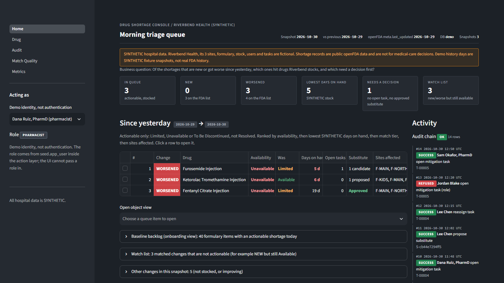
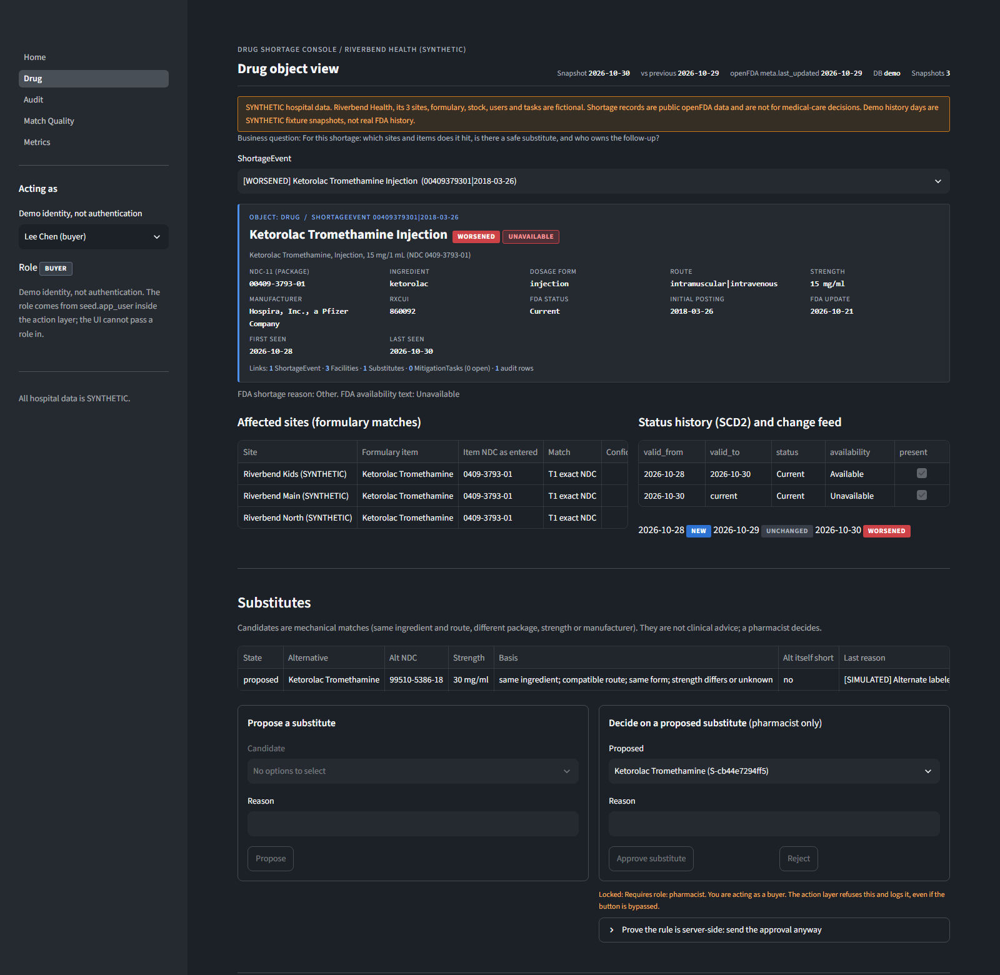
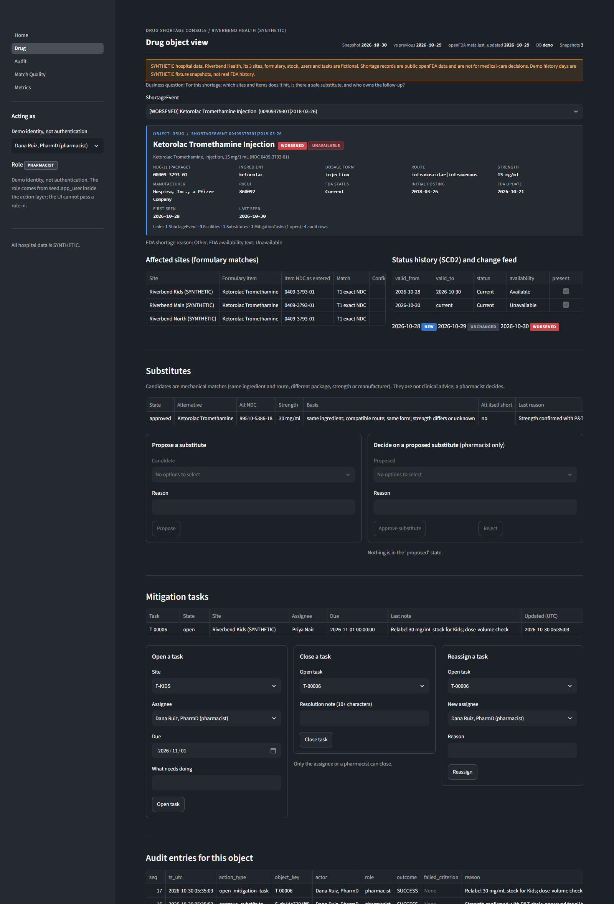
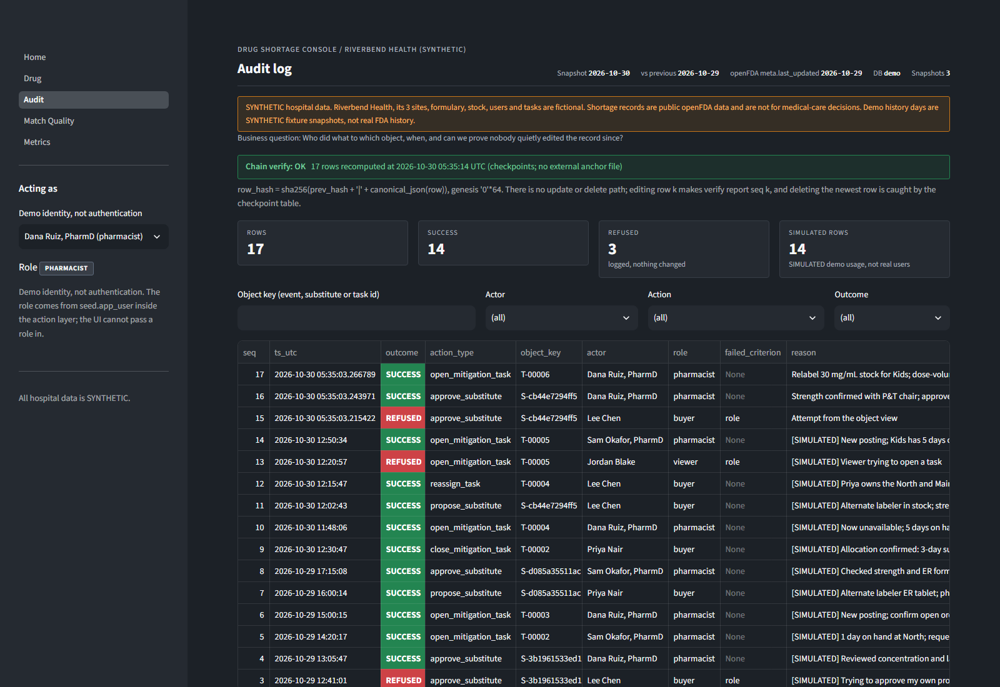
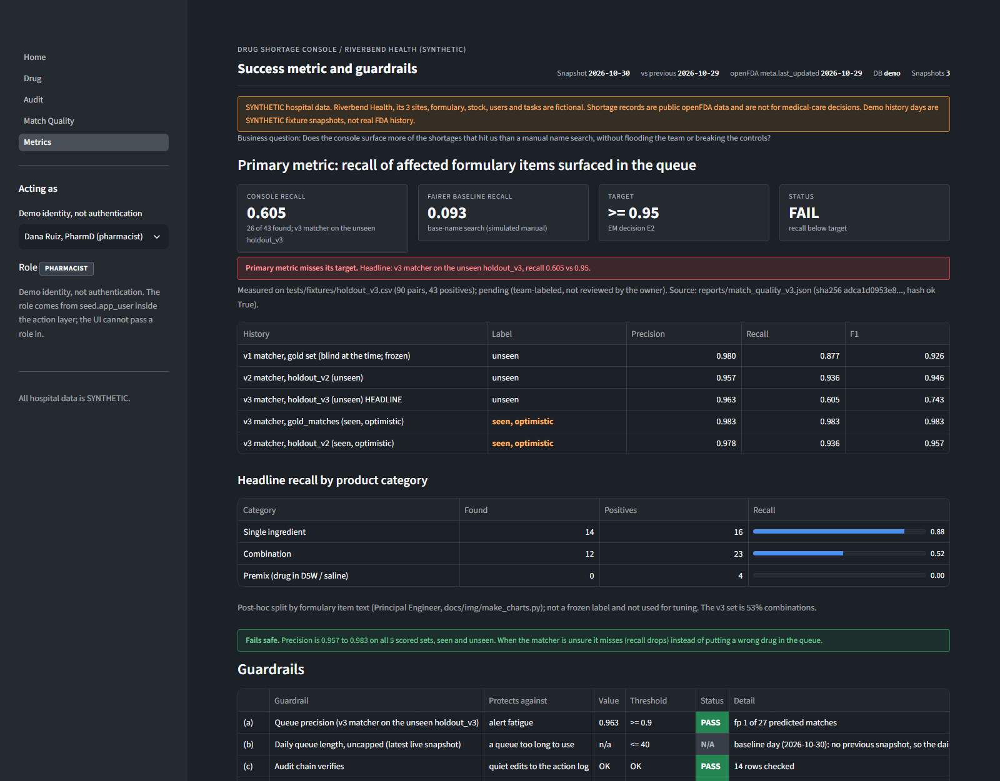
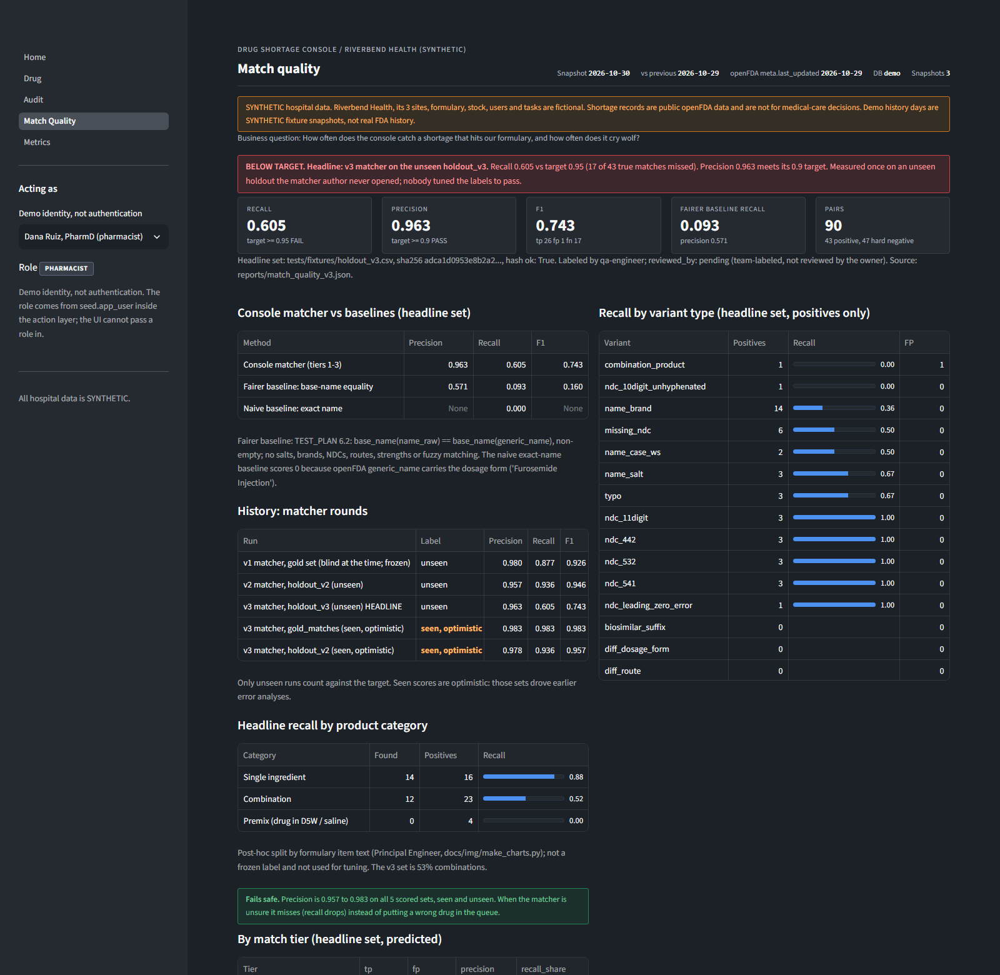

# Drug Shortage Console: the operations app

A Streamlit console over the ontology views. It is a **portfolio project**. **SYNTHETIC hospital, simulated users.** Shortage records are public openFDA data. Riverbend Health, its 3 sites, formulary, stock, users and tasks are fictional. The demo history days are SYNTHETIC fixture snapshots.

```
python -m pipeline.run --fixtures     # build data/demo/console.duckdb (offline)
python -m console.simulate            # optional: SIMULATED demo usage (idempotent), refreshes metrics
streamlit run app/Home.py             # http://localhost:8501   (DSC_DB=live for the live DB)
```

The app holds no business logic (ADR 001). Pages read through `console.queries` and write only through `console.actions`. Each rerun opens one DuckDB connection and closes it. The role on every button comes from the same `ontology.yaml` the action layer enforces, and the action layer checks it again on every call.

## Pages and the question each one answers

| Page | Business question | Reads |
|---|---|---|
| **Home: morning triage queue** | Of the shortages new or worse since yesterday, which hit drugs we stock, and which need a decision first? | `mart.triage_queue`, `core.change_feed`, audit tail |
| **Drug: object view** | For this shortage: which sites and items does it hit, is there a safe substitute, and who owns the follow-up? | `obj.drug`, `obj.shortage_event`, `link.*`, `obj.substitute`, `obj.mitigation_task`, `core.shortage_history` |
| **Audit** | Who did what to which object, and can we prove nobody quietly edited the record? | `audit.action_log`, `verify_chain` |
| **Match Quality** | How often does the console catch a shortage that hits our formulary, and how often does it cry wolf? | `reports/match_quality.json` |
| **Metrics** | Does the console beat a manual name search without flooding the team or breaking the controls? | `console.metrics` (live), `reports/match_quality.json` |

## Honest results (team-labeled, reviewed_by pending)

Headline: the **v3 matcher, scored once on holdout_v3**, the newest blind set (90 pairs, 43 positives, 53% combinations).

| Run | Precision | Recall | F1 | Note |
|---|---|---|---|---|
| **v3 matcher, holdout_v3 unseen (headline)** | 0.963 | **0.605** | 0.743 | recall misses 0.95 badly; precision meets 0.90 |
| Fairer baseline, base-name search, same holdout | 0.571 | 0.093 | 0.160 | the comparison |
| v1 matcher, gold set | 0.980 | 0.877 | 0.926 | history; blind when it ran |
| v2 matcher, holdout_v2 | 0.957 | 0.936 | 0.946 | history; blind when it ran |
| v3 matcher, gold set / holdout_v2 | 0.983 / 0.978 | 0.983 / 0.936 | | **seen, optimistic** |

Headline recall by product category (post-hoc split by item text): single ingredient 14/16, combinations 12/23, premixes 0/4. **The matcher fails safe**: precision is 0.957 to 0.983 on every set, so when it is unsure it misses an item rather than queueing a wrong drug.

Match Quality shows a red banner and Metrics shows FAIL. The headline run is chosen in one place, `console.metrics.load_quality` (the newest `reports/match_quality_vN.json`). The numbers are never typed by hand. The full guardrail table is in [docs/impact.md](../docs/impact.md).

## Click-through (AC-5.6), screenshots in `docs/demo/`

Taken with the installed Chrome (headless) against a scratch copy of the demo DB on localhost.

1.  **Queue (ADR 007):** since yesterday (2026-10-29 to 2026-10-30), 3 actionable shortages are NEW or WORSENED and stocked. They are ranked (Unavailable first, then lowest SYNTHETIC days on hand, match tier, sites) and capped at 40 with "N more". The 3 still-Available NEW events sit on the Watch list. On a baseline day (first snapshot), Home shows a one-time item-grain review list instead; the live day has 73 items. The activity rail shows the audit chain status.
2.  **Object view as Lee Chen (buyer):** "Approve substitute" is disabled, and the page gives the reason from the ontology. "Send the approval anyway" calls the action layer directly. It is refused and logged.
3.  **As Dana Ruiz (pharmacist):** the substitute is approved and a task is opened. The object's audit rows update on the next rerun, with no rebuild.
4.  **Audit page:** chain verify OK with its time. The buyer's REFUSED attempt (criterion `role`) sits next to the SUCCESS rows.
5.  **Metrics:** headline v3 recall 0.605 on the newest blind set fails the 0.95 target (red). The v1 to v2 to v3 history is listed with the seen rows marked, then recall by category and the fail-safe note. Guardrails a, c, d and e pass; b is N/A with one live snapshot. Time to first action is labeled SIMULATED.
6.  **Match quality:** the v3 holdout headline next to the fairer and naive baselines, the v1 to v2 to v3 history, recall by category (single, combination, premix), the fail-safe note, per tier, per variant, and every failing pair with its rationale.

## Demo conveniences (not security)

- The sidebar user picker is **demo identity, not authentication**. `?as=<user_id>` preselects a demo user, and `?event=<event_key>` opens an object. Neither one can grant a role.
- `DSC_DB_PATH` points the app at another DuckDB file. Tests and screenshots use it so the repo DB is not touched.

## Tests

`tests/test_app.py` runs every page headless with `streamlit.testing.v1.AppTest`. It checks the role-gated approve button for a buyer, a viewer and a pharmacist, an approve through the form, a forced buyer approve refused server-side, chain verify OK, and the SYNTHETIC label. The query and metric logic is reconciled to the base tables in `tests/test_queries.py` and `tests/test_metrics.py`.
